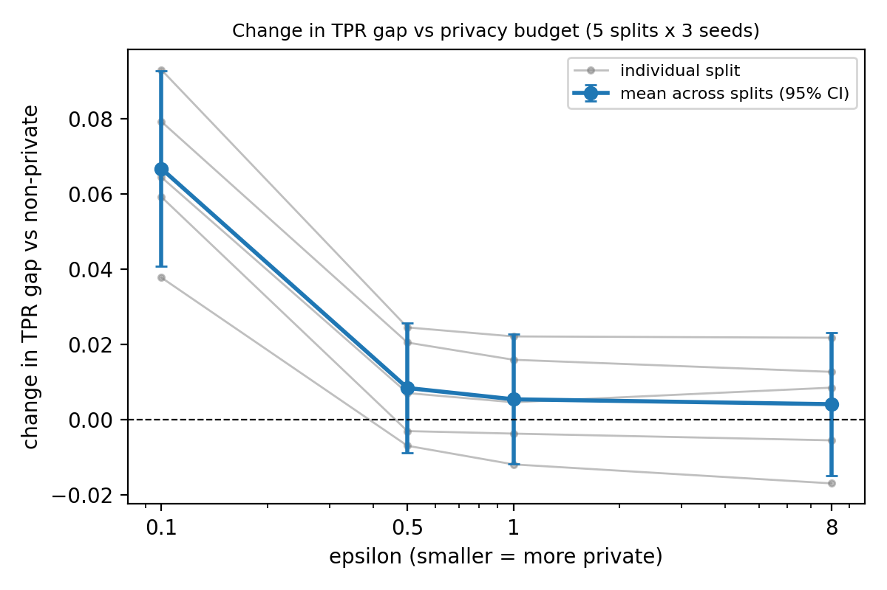

# Does differential privacy widen group gaps? An empirical check on UCI Adult

A small, reproducible study of how DP-SGD affects a gender gap in recall
(true positive rate) for a linear income classifier on UCI Adult.

## Question
How does training with differential privacy (DP-SGD) change accuracy and the
male-minus-female true-positive-rate (TPR) gap as the privacy budget epsilon tightens?

## Setup
- Data: UCI Adult (OpenML "adult", version 2), 48,842 rows; target income > $50K.
  Sensitive attribute for evaluation: `sex` (binary). `sex` is also a model feature.
- Model: one linear layer (105 input features after preprocessing), Adam, lr 0.01,
  10 epochs, batch size 512 for non-private runs.
- Private runs: DP-SGD with Opacus 1.6.0 (PRV accountant), delta = 1e-5,
  clipping norm 1.0 unless stated. Poisson sampling at rate 0.0149
  (expected batch about 510), 670 steps.
- Epsilon values: 0.1, 0.5, 1, 4 (original split only), 8, plus a non-private model.
- Primary evaluation: 5 train/test splits (random_state 1 to 5, stratified 70/30)
  x 3 seeds. Changes are paired against the non-private model within each split and
  seed, averaged over seeds, and summarised with a 95% t-interval across the 5 splits.
- Exploratory: the original split (random_state 0) x 10 seeds, where the question
  arose. Extra analyses (selection-rate matching, clipping sensitivity, a no-noise
  clipping ablation) were chosen after seeing results and are post hoc.

## Main results
All numbers are produced by `python src/analyze.py`; see `results/analysis_output.txt`.

- Non-private TPR gap varies by split (0.087 to 0.164; mean 0.130, sd 0.032), so
  paired changes are reported, not absolute gaps.
- Epsilon 0.1: the TPR gap widens in all five splits, by +0.067 on average
  (95% CI +0.041 to +0.093); +0.064 (+0.043 to +0.085) after matching the overall
  selection rate. Women's recall falls by 0.104 (CI -0.118 to -0.090), men's by 0.037
  (CI -0.053 to -0.021). Accuracy falls by 0.008; within-group AUC falls by 0.011
  (men) and 0.012 (women).
- Epsilon 0.5, 1 and 8 (epsilon 4 was run on the original split only): no detectable
  change in the gap (intervals include zero; effects up to about 0.025 cannot be ruled
  out with 5 splits). Both groups lose a little recall (women's recall at epsilon 0.5:
  -0.023, CI -0.039 to -0.007).
- Original split only (exploratory): the gap widens from 0.146 to 0.248 at epsilon 0.1.
  Clipping without noise raises the matched gap only to about 0.158; with noise, the
  widening appears at clipping norms 0.1, 1.0 and 5.0 (largest at 5.0). Because DP-SGD
  noise scales with the clipping bound, these runs do not separate the effect of noise
  from that of clipping, and the mechanism is untested. This was not repeated on other   splits.

## Limitations
- One dataset, one linear model, one binary sensitive attribute.
- UCI Adult is a 1994 census extract with a binary sex variable; results may not
  transfer to current data or to non-binary framings.
- Private runs reuse the non-private learning rate and epochs; only the clipping
  norm was varied. Other hyperparameters were not tuned.
- The DP guarantee covers only the training loop: imputation, scaling and
  one-hot encoding were fitted on the training data without privacy.
- Intervals reflect variation across training seeds and splits, not across datasets.
  The five splits are random resamples of the same 48,842 rows, so their test sets
  overlap (about 30% of any two test sets) and the splits are not independent; the
  across-split intervals are therefore probably somewhat too narrow, even though
  with 5 splits they are already wide.
- Mechanism is not identified: this study does not explain why noise hurts women's
  recall more.
- Achieved epsilon was 0.958 to 0.999 of the target in all private sweep runs.

## Reproduce
Developed on Windows, CPU only. Notebook exploration ran on Python 3.13.9; the
scripts were run on Python 3.14.3 with the same library versions and reproduced
the notebook's results.

    python -m venv .venv
    source .venv/Scripts/activate        # Git Bash on Windows
    pip install -r requirements.txt
    python src/run_sweep.py              # results/sweep_original_split.csv
    python src/run_multisplit.py         # results/multisplit.csv
    python src/run_clip.py               # results/clip_experiments.csv
    python src/analyze.py | tee results/analysis_output.txt

Runs are seed-deterministic on the machine tested (identical outputs for repeated
seeds); other hardware or library versions were not tested.

`notebooks/PrivacyPreservingML.ipynb` is the exploratory record. It was run out of
order, so the scripts are the reproducible version.

## Follow-up
Exploratory mechanism checks (with predictions committed before running)
are in notes/predictions.md and notes/mechanism_results.md.